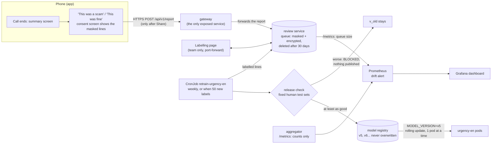

# Workstream H: learning new scams in cloud mode, and shipping updates

The cloud never keeps conversations by default, so it can't simply "learn from all calls". Instead it learns
in three steps, and a person stays in charge of each one:

1. **Notice** that something new is happening, from scores only (no text is stored).
2. **Collect** examples only from users who agree to share a call, masked and deleted after 30 days.
3. **Retrain, check, ship**: a scheduled Job retrains, a release check blocks anything worse, and a rolling
   update replaces the worker pods one at a time with no downtime, and can be undone.



## What was built (H.1–H.10)

| Task | What | Where |
|---|---|---|
| H.1 Score monitoring | The aggregator exports counts only: verdict per caller line, BERT outcomes, worker/BERT disagreements by direction, average score per signal. Prometheus scrapes every aggregator pod; Grafana shows the dashboard. | `backend/aggregator/src/metrics.rs`, `demo/make_monitoring.py` |
| H.2 Drift alert | `PossibleNewScam` fires when the UNSURE share, or the disagreement rate, over the last hour is 1.5× its level over the day before (and UNSURE is at least 15% of lines). | `demo/make_monitoring.py` |
| H.3 Report buttons + consent | "This was a scam" / "This was fine" on the call summary. A consent screen lists exactly what will be sent (the caller's lines, already masked on the phone) and what won't. Nothing is sent on "Don't share". | `ui/OtherScreens.kt`, `logic/Mask.kt` |
| H.4 Review queue | Internal service. Requires `consent: true`, masks again on arrival, stores text **encrypted** (key in a Kubernetes Secret, not on the same disk), deletes everything 30 days after the report. The phone reaches it only through the gateway's `POST /v1/report`. | `backend/review/` |
| H.5 Labelling | A web page for the team: label each line for urgency / money / impersonation using the LABELING.md rules, or skip it. A **spot check** tab shows someone else's labels; a label a second person disagrees with is left out of training. | `backend/review/labelling.html` |
| H.6 Retraining Job | A Kubernetes CronJob (Sundays 03:00) that runs only when at least 50 new labelled lines are waiting. It runs the worker's own `train.py` on the original data plus every labelled report line. | `backend/retrain/retrain_job.py`, `demo/k8s/10-retrain.yaml` |
| H.7 Release check | The new model and the one in service both score the fixed human test sets (`gold_handwritten`, `robocall_gold`). The new one must match on ROC-AUC and F1 (within 0.005). Otherwise the Job fails and nothing is published. | `backend/retrain/release_check.py` |
| H.8 Versions | Released models live in the registry as v5, v6..., each with its sha256 and release-check scores, never overwritten. The worker loads the version in `MODEL_VERSION` and reports it in every answer (`model_version` in the proto; `model_versions` in the gateway's reply). | `backend/workers/urgency_en/server.py`, `scam_detect.proto` |
| H.9 Rolling update | `learning.py rollout v5` sets `MODEL_VERSION`; Kubernetes starts a new pod, waits until it's ready, then removes an old one (`maxSurge 1, maxUnavailable 0`). `--during-call` keeps a call running through it and reports any failed lines. A version that fails to load never becomes ready, so the old pods keep serving. Every worker pauses 5 s before stopping (`preStop`), so Envoy stops sending it lines before it goes. | `demo/tools/learning.py` |
| H.10 Rollback | `learning.py rollback` = `kubectl rollout undo`; `kubectl rollout history` shows each revision's model change. | `demo/tools/learning.py` |

Model versions are delivered through the registry rather than as new image tags (`urgency-en:v5`): building
images inside the cluster would need an image builder and a registry, while the worker downloading a checked
file at start-up gives the same rolling update and rollback with far less machinery.

## Privacy, in one place

- **Nothing leaves the phone without a tap on Share**, and the consent screen shows the exact text.
- **Masked twice** (phone and server): numbers, amounts, links, e-mails, ID numbers, and names after "my name is",
  "this is", "Officer"... A name said any other way is not caught, so labellers skip lines that still have one.
- **Not stored**: phone numbers, user IDs, the receiver's side of the call, the call ID.
- **Encrypted at rest** (Fernet). The key is a Kubernetes Secret, so a copy of the volume alone is unreadable.
- **Deleted after 30 days**, together with its labels. A model trained on it keeps what it learned, but the
  text is gone.
- **Internal only**: the queue, labelling page and registry have ClusterIP Services and no Ingress rule.
- **Monitoring is counts only**: the aggregator's metrics and Prometheus never see text.

## Run it

With the cluster up (`demo/up.ps1` or `up.sh`) and `demo/expose.ps1` or `expose.sh` running:

```bash
python demo/tools/learning.py status                     # model version, queue, registry, jobs
python demo/tools/learning.py report                     # play a scam call and report it (or use the app)
python demo/tools/learning.py review                     # labelling page on http://127.0.0.1:8090/
python demo/tools/learning.py retrain --force            # retrain now (normally weekly / at 50 labels)
python demo/tools/learning.py rollout v5 --during-call   # rolling update with a live call running
python demo/tools/learning.py rollback                   # undo
python demo/tools/learning.py monitoring up              # Grafana http://127.0.0.1:3000 (optional, ~400 MB)
```

To see the release check block a model: `learning.py retrain --force --tolerance -0.05` (demands a 0.05
improvement, which a handful of new lines can't give).

## Measured

Run on 2026-11-02 on minikube v1.39.0 (lite profile, 12 CPUs / 8 GiB laptop), through the Workstream E HTTPS
address, with `learning.py` as above.

| Step | Result |
|---|---|
| Report a 4-line parcel scam that the system called **SAFE** all the way through (urgency only, no money or bank) | Stored as report 1 through Ingress → gateway → review; lines masked |
| Report without `consent: true` | 400 "consent is required: nothing was sent" |
| "This was fine" report with a phone number and a time | Stored as `... on [PHONE_NUMBER] ...`, `... at [NUMBER]pm ...` |
| Database on disk | No readable text (searched the SQLite file for a word from a report: 0 hits) |
| 30-day deletion (tested with 0 days) | Report, its lines and their labels all removed |
| Spot check by the labeller themself | Refused; a disputed label is left out of the training file |
| Retraining Job in the cluster (`--force`) | v5 trained on the original data + 4 reported lines in **83 s**, under the 1.5 GiB limit |
| Release check v5 vs v4 | gold_handwritten ROC-AUC 0.8228 → 0.8333, F1 0.7419 → 0.7419; robocall ROC-AUC 0.9229 → 0.9221 (inside the 0.005 tolerance), F1 0.3717 → 0.3962 → **PASS**, published |
| Release check with `--tolerance -0.05` (must be 0.05 better) | **BLOCKED**, Job Failed, registry unchanged, the new labels stay waiting |
| Worker with `MODEL_VERSION=v9` (not released) | Refuses to start (404 from the registry), so the old pods keep serving |
| Same reported-style sentence, v4 vs v5 | urgency 0.51 → 0.74: the new version learned the new script |
| Rolling update v4 → v5 during a live call (first try) | 21 lines, **0 failed**, but 2 lines came back without an urgency score: Envoy still routed to the stopping pod for up to its 2 s refresh |
| Same, after adding a 5 s `preStop` pause to every worker | v5 → v4: 23 lines, 0 failed, 0 missing; rollback v4 → v5: 21 lines, 0 failed, 0 missing; each switch ~7 s. For those few seconds both versions answer, which is expected in a rolling update |
| `kubectl rollout history` | `urgency_en model v5 -> v4`, then `rollback: urgency_en model v4 (baked) -> v5` |
| Re-applying the manifests (as `up` does) | `MODEL_VERSION=v5` kept: re-running `up` doesn't roll a released model back |

Monitoring (`learning.py monitoring up`, then the 4 `demo_flow.py` calls):

| Check | Result |
|---|---|
| Prometheus targets | aggregator pod `:8082/metrics` up, review `:8090/metrics` up |
| Rules | 3 recording rules + `PossibleNewScam` loaded, health ok |
| Counts after the calls | 103 lines: 73 SAFE, 5 UNSURE, 25 SCAM; 8 calls started; BERT ok 4, timeout 1, skipped 93 |
| UNSURE share (recorded, 1 h window) | 0.147 |
| Drift alert | Not firing: no day-before baseline yet on a fresh cluster (see limits) |
| Grafana | Dashboard "ScamGuard: learning new scams" provisioned, 10 panels; registry shows urgency_en v5 |

## Honest limits (say these in the report)

- **Per line, not per call.** "Share of SAFE/UNSURE/SCAM calls" needs a clear end of call (Workstream B).
  Until then the dashboard shows the share of caller lines; the metric names leave room for a per-call count.
- **Only urgency_en retrains.** It is the only worker with a complete `train.py` and fixed gold test sets. The
  same Job works for the others once Workstream D gives money_en a real `train.py` (D.7) and gold sets.
- **The drift alert needs history.** It compares with the day before, so on a fresh cluster it can't fire for a
  day. For a live demo, regenerate with short windows: `DRIFT_SHORT=2m DRIFT_BASELINE=30m python demo/make_manifests.py`.
- **A brand-new scam nobody reports can't be learned** (no label). The drift alert only says "look".
- **Release-check tolerance.** A retrain on a few new lines moves the scores by a few thousandths either way;
  0.005 absorbs that. A model that is really worse still fails.
- **No canary.** Running the new version on 1 of 3 pods first would need a second Deployment sharing the
  Service, which Kubernetes discourages (overlapping selectors). The rolling update + rollback covers the
  "ship safely" part; a canary is the next step.
- **Labels are human, so they're slow.** Retraining waits for 50 new labelled lines by default.

## For the report (one paragraph)

> Our cloud design learns new scams without storing conversations by default. The aggregator exports only
> counts (verdict shares, worker/BERT disagreement), and a Prometheus alert flags a rise as a possible new scam
> script. Users can share a finished call from the summary screen; the consent screen shows the exact masked
> text, and the review service stores it encrypted for at most 30 days, reachable only inside the cluster.
> Team members label the lines with the same written rules used for training, with a second person
> spot-checking. A Kubernetes CronJob then retrains the worker on the original data plus the reviewed lines, and
> a release check publishes the new version only if it scores at least as well on fixed human-labelled test
> sets. Rolling the new version out is a Kubernetes rolling update, one pod at a time, with no failed requests
> during a live call, and a single command rolls it back.
