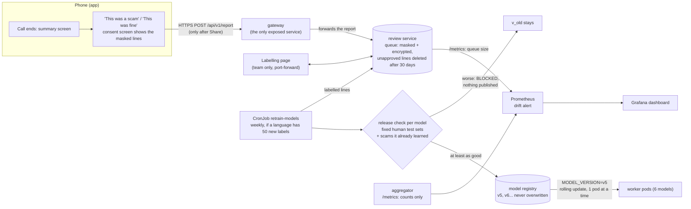

# Workstream H: learning new scams in cloud mode, and shipping updates

The cloud never keeps conversations by default, so it can't simply "learn from all calls". Instead it learns
in three steps, and a person stays in charge of each one:

1. **Notice** that something new is happening, from scores only (no text is stored).
2. **Collect** examples only from users who agree to share a call. They are masked, and deleted after 30 days
   unless a reviewer approved the line as a training example.
3. **Retrain, check, ship**: a scheduled Job retrains all three models of the language the new scam is in, a
   release check blocks anything worse, and a rolling update replaces the worker pods one at a time with no
   downtime, and can be undone.



## What was built (H.1–H.10)

| Task | What | Where |
|---|---|---|
| H.1 Score monitoring | The aggregator exports counts only: verdict per caller line, BERT outcomes, worker/BERT disagreements by direction, average score per signal. Prometheus scrapes every aggregator pod; Grafana shows the dashboard. | `backend/aggregator/src/metrics.rs`, `demo/make_monitoring.py` |
| H.2 Drift alert | `PossibleNewScam` fires when the UNSURE share, or the disagreement rate, over the last hour is 1.5× its level over the day before (and UNSURE is at least 15% of lines). | `demo/make_monitoring.py` |
| H.3 Report buttons + consent | "This was a scam" / "This was fine" on the call summary. A consent screen lists exactly what will be sent (the caller's lines, already masked on the phone) and what won't. Nothing is sent on "Don't share". | `ui/OtherScreens.kt`, `logic/Mask.kt` |
| H.4 Review queue | Internal service. Requires `consent: true`, masks again on arrival, stores text **encrypted** (key in a Kubernetes Secret, not on the same disk). 30 days after the report it deletes everything except lines a person labelled and nobody disputed or skipped, and it keeps those only if the user's consent screen said so (`consent_version` 2). The phone reaches it only through the gateway's `POST /v1/report`. | `backend/review/` |
| H.5 Labelling | A web page for the team: label each line for urgency / money / impersonation using the LABELING.md rules, or skip it. A **spot check** tab shows someone else's labels; a label a second person disagrees with is left out of training. | `backend/review/labelling.html` |
| H.6 Retraining Job | A Kubernetes CronJob (Sundays 03:00) that acts when a language has at least 50 new labelled lines. Each line is labelled for all three signals, so all three of that language's models retrain, each with its own `train.py` on its original data plus every labelled report line. Chinese reports never trigger English models, or the reverse. One blocked model doesn't stop the others. Each model trains in the scikit-learn version its worker serves with (1.4.2 or 1.6.1, two environments in one image). | `backend/retrain/retrain_job.py`, `retrain_one.py`, `adapters.py`, `demo/k8s/10-retrain.yaml` |
| H.7 Release check | The new model and the newest released one (or the baked one) both score that worker's fixed human test sets (`adapters.py` lists them). The new one must match on ROC-AUC and F1 (within 0.005), and must still recognise the reported scam lines earlier versions learned (recall). Otherwise that model isn't published, and the Job shows as Failed. | `backend/retrain/release_check.py` |
| H.8 Versions | Released models live in the registry as v5, v6..., each with its sha256 and release-check scores, never overwritten. All six workers load the version in `MODEL_VERSION` and report it in every answer (`model_version` in the proto; `model_versions` in the gateway's reply). | `backend/workers/common/model_registry.py`, `scam_detect.proto` |
| H.9 Rolling update | `learning.py rollout latest` sets `MODEL_VERSION` on every worker with a newer release, one worker at a time (`rollout v5 --model urgency_en` for just one); Kubernetes starts a new pod, waits until it's ready, then removes an old one (`maxSurge 1, maxUnavailable 0`). `--during-call` keeps a call running through it and reports any failed lines. A version that fails to load never becomes ready, so the old pods keep serving. Every worker pauses 5 s before stopping (`preStop`), so Envoy stops sending it lines before it goes. | `demo/tools/learning.py` |
| H.10 Rollback | `learning.py rollback` = `kubectl rollout undo` for every worker on a release (`--model` for just one); `kubectl rollout history` shows each revision's model change. | `demo/tools/learning.py` |
| H.10 Canary | `learning.py canary v5 --model urgency_en`: 1 pod on v5, 3 on the current version, same Deployment (no second Deployment, so no overlapping selectors). Test traffic shows `model_versions` per answer; `canary promote` finishes the update, `canary abort` undoes it. | `demo/tools/learning.py` |

The Chinese workers build their models inside their images, so their first registry version is v2 and the baked
model counts as v1. The retraining image builds the same baselines to compare against.

Model versions are delivered through the registry rather than as new image tags (`urgency-en:v5`): building
images inside the cluster would need an image builder and a registry, while the worker downloading a checked
file at start-up gives the same rolling update and rollback with far less machinery.

## Privacy, in one place

- **Nothing leaves the phone without a tap on Share**, and the consent screen shows the exact text. It also says
  masking can miss things, so the user should check.
- **Masked twice** (phone and server): digits, amounts, links, e-mails, ID numbers, and names after "my name is",
  "this is", "Officer"... **Masking is not complete.** It misses names said any other way, numbers read out as words
  ("four seven two nine", 一三八...), addresses, and unusual domains. So a person reads every line, and labellers
  must skip a line with anything personal left: a skipped line is deleted, a labelled one can be kept.
- **Not stored**: phone numbers, user IDs, the receiver's side of the call, the call ID.
- **Encrypted at rest** (Fernet). The key is a Kubernetes Secret, so a copy of the volume alone is unreadable.
- **Deleted after 30 days**, except lines a reviewer approved, when the user's consent screen covered that. Without
  those kept lines the next retrain, which starts from the original data, would forget the scam. A kept line stays
  masked and encrypted and has no link to a user, which also means nobody can ask for their line back later. Reports
  from an older app (`consent_version` 1, "deleted after 30 days") are deleted in full, as promised.
- **Internal only**: the queue, labelling page and registry have ClusterIP Services and no Ingress rule.
- **Monitoring is counts only**: the aggregator's metrics and Prometheus never see text.

## Run it

With the cluster up (`demo/up.ps1` or `up.sh`) and `demo/expose.ps1` or `expose.sh` running:

```bash
python demo/tools/learning.py status                     # model versions, queue, registry, jobs
python demo/tools/learning.py report                     # play a scam call and report it (or use the app)
python demo/tools/learning.py review                     # labelling page on http://127.0.0.1:8090/
python demo/tools/learning.py retrain --force            # retrain now (normally weekly, at 50 new labels)
python demo/tools/learning.py rollout latest --during-call   # rolling update with a live call running
python demo/tools/learning.py rollback                   # undo
pytest backend/review                                    # retention and retrain-trigger rules
python demo/tools/learning.py monitoring up              # Grafana http://127.0.0.1:3000 (optional, ~400 MB)
```

To see the release check block a model: `learning.py retrain --force --tolerance -0.05` (demands a 0.05
improvement, which a handful of new lines can't give).

## Test it on a phone

The app has two test calls: **New scam test A report this** and **New scam test B same scam new words**. They are a
fake job scam asking for USDT top-ups, which every model misses today. B says the same thing in different words and
is never reported, so it shows the models learned the scam rather than the sentences.

With `up` and `expose` running and the phone connected:

1. Play **B** and then **A**. Both should end **SAFE**.
2. On A's summary screen tap **This was a scam**, read the consent screen, tap **Share**.
3. `python demo/tools/learning.py review`, open http://127.0.0.1:8090/, type a name and label the lines:

   | Line | Urgency | Money | Impersonation |
   |---|---|---|---|
   | Good evening, our recruiter saw your profile... | No | No | No |
   | You just rate products on our platform... | No | No | No |
   | The first task needs a small top up in USDT... | No | **Yes** | No |
   | I will add you to the Telegram group... | No | No | No |
   | Top up again today to unlock the next task... | **Yes** | **Yes** | No |
   | Slots fill up fast so please decide tonight. | **Yes** | No | No |

4. `python demo/tools/learning.py retrain --force --tolerance 0.015` (about 7 minutes). See "Release-check tolerance"
   below for why this test needs the flag.
5. `python demo/tools/learning.py rollout latest`
6. Play **A**, **B** and a normal call again: A and B now end **SCAM** and the normal call stays **SAFE**.
7. `python demo/tools/learning.py rollback` puts the old models back, and B and A are missed again.

## Measured: all six models

Run on 2026-11-06 on minikube (lite profile, 8 GiB for Docker), playing the two test calls with the app's timing.

| Check | Result |
|---|---|
| A and B before | SAFE, SAFE (highest money 0.84 / 0.72; urgency stays under 0.5, so the money rule doesn't fire) |
| Retrain at the default tolerance | money_en v3 and impersonation_en v5 published; **urgency_en v6 BLOCKED** (robocall F1 0.3962 -> 0.3860); Chinese models not touched, as no Chinese report existed |
| After those two rolled out | Money scores rise, also on B's unseen wording (0.10 -> 0.64, 0.72 -> 0.95), but the verdict stays SAFE without urgency |
| Retrain with `--tolerance 0.015` | urgency_en v6 published, urgency_zh, money_zh and impersonation_zh v2 published from a 5-line Chinese report, all inside the 1.5 GiB limit |
| A and B after all models rolled out | **SCAM, SCAM** |
| Normal clinic call; normal bank reminder; bank OTP scam | SAFE -> SAFE; SCAM -> **SAFE** (an old false alarm gone); SCAM -> SCAM |
| Rollouts during a live call | money_en 30 lines, impersonation_en 47 lines: 0 failed |
| `learning.py rollback`, all six, during live calls | 165 lines, 0 failed; each model back to its previous version |
| Retention rules | `pytest backend/review`: 7 passed, including a volume from before consent versions |

BERT was not retrained, and on these calls it still scores about 0.005. The verdict changes through the workers' money
rule (money >= 0.7 and another signal >= 0.5), which BERT doesn't override.

## Measured: urgency_en, the first version

Run on 2026-11-02 on minikube v1.39.0 (lite profile, 12 CPUs / 8 GiB laptop), through the Workstream E HTTPS
address, with `learning.py` as above.

| Step | Result |
|---|---|
| Report a 4-line parcel scam that the system called **SAFE** all the way through (urgency only, no money or bank) | Stored as report 1 through Ingress → gateway → review; lines masked |
| Report without `consent: true` | 400 "consent is required: nothing was sent" |
| "This was fine" report with a phone number and a time | Stored as `... on [PHONE_NUMBER] ...`, `... at [NUMBER]pm ...` |
| Database on disk | No readable text (searched the SQLite file for a word from a report: 0 hits) |
| 30-day deletion (tested with 0 days) | Report, its lines and their labels all removed |
| Spot check by the labeller themself | Refused; a disputed label is left out of the training file |
| Retraining Job in the cluster (`--force`) | v5 trained on the original data + 4 reported lines in **83 s**, under the 1.5 GiB limit |
| Release check v5 vs v4 | gold_handwritten ROC-AUC 0.8228 → 0.8333, F1 0.7419 → 0.7419; robocall ROC-AUC 0.9229 → 0.9221 (inside the 0.005 tolerance), F1 0.3717 → 0.3962 → **PASS**, published |
| Release check with `--tolerance -0.05` (must be 0.05 better) | **BLOCKED**, Job Failed, registry unchanged, the new labels stay waiting |
| Worker with `MODEL_VERSION=v9` (not released) | Refuses to start (404 from the registry), so the old pods keep serving |
| Same reported-style sentence, v4 vs v5 | urgency 0.51 → 0.74: the new version learned the new script |
| Rolling update v4 → v5 during a live call (first try) | 21 lines, **0 failed**, but 2 lines came back without an urgency score: Envoy still routed to the stopping pod for up to its 2 s refresh |
| Same, after adding a 5 s `preStop` pause to every worker | v5 → v4: 23 lines, 0 failed, 0 missing; rollback v4 → v5: 21 lines, 0 failed, 0 missing; each switch ~7 s. For those few seconds both versions answer, which is expected in a rolling update |
| `kubectl rollout history` | `urgency_en model v5 -> v4`, then `rollback: urgency_en model v4 (baked) -> v5` |
| Re-applying the manifests (as `up` does) | `MODEL_VERSION=v5` kept: re-running `up` doesn't roll a released model back |

Monitoring (`learning.py monitoring up`, then the 4 `demo_flow.py` calls):

| Check | Result |
|---|---|
| Prometheus targets | aggregator pod `:8082/metrics` up, review `:8090/metrics` up |
| Rules | 3 recording rules + `PossibleNewScam` loaded, health ok |
| Counts after the calls | 103 lines: 73 SAFE, 5 UNSURE, 25 SCAM; 8 calls started; BERT ok 4, timeout 1, skipped 93 |
| UNSURE share (recorded, 1 h window) | 0.147 |
| Drift alert | Not firing: no day-before baseline yet on a fresh cluster (see limits) |
| Grafana | Dashboard "ScamGuard: learning new scams" provisioned, 10 panels; registry shows urgency_en v5 |

## Honest limits (say these in the report)

- **Per line, not per call.** "Share of SAFE/UNSURE/SCAM calls" needs a clear end of call (Workstream B).
  Until then the dashboard shows the share of caller lines; the metric names leave room for a per-call count.
- **BERT doesn't retrain.** It is a 136 MB DistilBERT fine-tuned in a GPU notebook, which a CPU Job with 1.5 GiB can't
  do. The six fast workers retrain; BERT needs its notebook rerun by hand. A new scam can therefore keep a low BERT
  score, which lowers the combined score until a rule such as the money rule fires.
- **The drift alert needs history.** It compares with the day before, so on a fresh cluster it can't fire for a
  day. For a live demo, regenerate with short windows: `DRIFT_SHORT=2m DRIFT_BASELINE=30m python demo/make_manifests.py`.
- **A brand-new scam nobody reports can't be learned** (no label). The drift alert only says "look".
- **Release-check tolerance.** 0.005 is smaller than one test line on the smaller test sets, so changing a few
  answers can block a model. In the measured run urgency_en v6 improved every ROC-AUC but got 1 more catch and about 7
  more false alarms on the robocall set (F1 -0.0102), so it was blocked. `--tolerance 0.015` lets it through for one
  run. Whether to accept that trade is a decision for a person, which is why the default wasn't changed.
- **The bar follows the newest release, with a floor.** Each release is compared with the newest one in the
  registry (not necessarily the one running, after a rollback) AND with the model baked into the image, so small
  drops inside the tolerance can't add up over many releases.
- **Internal services have no login.** Any pod in the cluster can read the queue or publish a model. The registry
  relies on the Job to run the release check; it doesn't enforce it.
- **`/v1/report` has no rate limit**, so reports could fill the 1 GiB volume.
- **Canary is manual.** `learning.py canary v5 --model urgency_en` runs v5 on ONE pod next to 3 old ones (it raises
  the autoscaler minimum to 3 and holds the rolling update after its first pod with `minReadySeconds`), sends test
  lines and shows which version answered each and its average score. A person then runs `canary promote` or
  `canary abort`. Nothing promotes or aborts it automatically.
- **Labels are human, so they're slow.** Retraining waits for 50 new labelled lines by default.

## For the report (one paragraph)

> Our cloud design learns new scams without storing conversations by default. The aggregator exports only
> counts (verdict shares, worker/BERT disagreement), and a Prometheus alert flags a rise as a possible new scam
> script. Users can share a finished call from the summary screen; the consent screen shows the masked text and
> says what is kept, and the review service stores it encrypted, reachable only inside the cluster. After 30 days
> only the lines a reviewer approved remain, as training examples with no link to a user. Team members label the
> lines with the same written rules used for training, with a second person spot-checking. A Kubernetes CronJob
> then retrains all three of that language's worker models on their original data plus the reviewed lines, and a
> release check publishes each new version only if it scores at least as well on fixed human-labelled test sets
> and still recognises the scams already learned. Rolling the new versions out is a Kubernetes rolling update, one pod at a time, with no failed requests
> during a live call, and a single command rolls it back. BERT is retrained separately, by hand.
