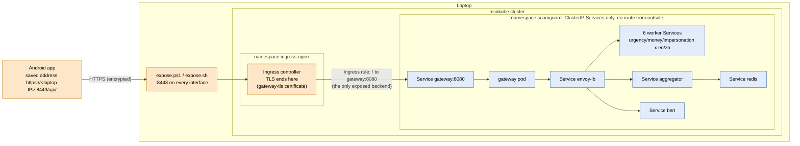

# Workstream E: a stable address for the phone

The panel asked: pod IPs change on every restart and the laptop's IP changes between networks, so how
does the phone always find the backend? There are two separate problems with two separate fixes.

| Problem | Fix | Where |
|---|---|---|
| **Inside the cluster**, a pod gets a new IP every time it restarts or scales. | Kubernetes **Services** give every component a fixed DNS name (`gateway`, `envoy-lb`, `urgency-en-hl`, `redis`, ...). Nothing inside the cluster ever uses a pod IP. | Already in place (`demo/k8s/01`–`07`) |
| **From the phone**, the backend needs one address that survives cluster restarts and gateway pod restarts. | One **Ingress** (ingress-nginx) in front of the gateway Service, with HTTPS. The phone saves the Ingress address once in Settings. | `demo/k8s/08-ingress.yaml`, `demo/expose.ps1`/`.sh` |

## E.1 Decision: Ingress on minikube

| Option | Chosen? | Why |
|---|---|---|
| **Ingress + hostname on minikube** | **Yes, for the demo** | Free, runs on the presenting laptop, and meets the "done when" on one Wi-Fi network. |
| Cloud VM (k3s) with a static IP | Described below as the next step | The only option where one address works on *any* network. The same `08-ingress.yaml` runs on it unchanged. |
| Managed Kubernetes LoadBalancer (EKS/GKE) | No | Costs money for no extra demo value. |

## E.5 What is internal and what is exposed



Orange = reachable from outside the cluster. Blue = internal only (ClusterIP or headless Services, reached
by name). **Only the gateway has an Ingress rule.** The workers, BERT, the aggregator, Envoy and Redis
cannot be reached from the phone or the Wi-Fi network at all.

Why the address doesn't change:

- **Gateway pod deleted or restarted**: the new pod gets a new IP, but the Ingress routes to the
  **gateway Service**, whose endpoint list Kubernetes updates on its own. The phone's address points at
  the Ingress, not at a pod, so nothing on the phone changes. The old `port-forward.ps1` was pinned to
  one gateway pod and dropped when that pod died; `expose.ps1` forwards to the Ingress controller, so
  deleting the gateway pod doesn't touch it.
- **Cluster restarted** (`minikube stop` / `start` + `up.ps1`): the Ingress, the certificate (kept in
  `demo/tls/`) and the port (8443) are recreated the same way, so the same saved address works again.
- **Laptop moves to a new Wi-Fi network**: the laptop's IP changes, so the address changes. Re-run
  `expose`, which re-issues the certificate for the new IP and prints the new address. Only the cloud VM
  option removes this limit.

### Why `expose` and not `minikube tunnel`

With minikube's Docker driver (Windows and Mac), `minikube tunnel` only listens on the laptop's own
`127.0.0.1`, which a phone on Wi-Fi can't reach. `expose` runs
`kubectl port-forward --address 0.0.0.0 -n ingress-nginx svc/ingress-nginx-controller 8443:443`, which
listens on every interface. It also restarts itself if the ingress controller ever restarts.

### Why the address ends in `/api/`

The Ingress serves the gateway under `/api/` (`/api/v1/utterance` reaches the gateway as `/v1/utterance`).
A request by IP address lands on nginx's catch-all server, which has its own hard-coded
`location /healthz { return 200; }` for load-balancer health checks. Without the prefix, the app's Test
connection got that empty 200 from nginx, not from the gateway, and said "Connected" even with the
gateway down. We found this by testing. With the prefix, nginx can't answer for the gateway, and the app
now also requires the gateway's own `{"status": "ok"}` before it says Connected.

## E.4 HTTPS

- `demo/make_tls.py` creates a private **ScamGuard demo CA** once (`demo/tls/ca.crt`) and a server
  certificate signed by it for `scamguard.test`, `localhost`, `127.0.0.1`, `10.0.2.2` (the emulator's name
  for the laptop) and the laptop's current private IPs. It loads it into the cluster as the `gateway-tls`
  Secret. `up` and `expose` run it automatically; it only re-issues the server certificate when the
  laptop's IP has changed. The CA never changes, so a device trusts it once.
- TLS ends at the Ingress controller. Inside the cluster, traffic to the gateway is plain HTTP on the
  cluster network, which is normal for a single-node demo. A production cluster would add a service mesh
  or gRPC TLS for pod-to-pod traffic.
- A phone that connects by IP address sends no hostname (no SNI), so `up` also makes `gateway-tls`
  ingress-nginx's `--default-ssl-certificate`.
- `demo/tls/` holds private keys and is gitignored. Every teammate who runs `up` gets their own CA.
- **The app** (`res/xml/network_security_config.xml`): debug builds trust CAs the user installed on the
  device, so nothing is baked into the APK. Release builds trust only the system CAs (Let's Encrypt on a
  cloud VM). Plain `http://` still works for `docker compose`, and Settings shows "Not encrypted" in red
  when the saved address is `http://`.

### Install the demo CA on a device (once per device)

1. Copy `demo/tls/ca.crt` to the device. On an emulator, drag the file onto the emulator window; it lands
   in Downloads. On a phone, use USB or `adb push demo/tls/ca.crt /sdcard/Download/`.
2. Settings → Security & privacy → More security settings → Encryption & credentials → **Install a
   certificate** → **CA certificate** → Install anyway → pick `ca.crt`. (Menu names vary a little by
   Android version; search Settings for "CA certificate".) Android requires a screen lock to install one.
3. In the app: Settings → "Emulator (HTTPS)" (or type the address `expose` printed) → **Test connection**
   → `Connected: ok` → **Save**.

If Test connection says *Certificate not trusted*, step 2 didn't take. If it says *Certificate doesn't
cover this address*, the laptop's IP changed: re-run `expose`.

## E.3 App settings

Already built in task 4.8: the server address is a setting (saved in SharedPreferences) with a **Test
connection** button that calls `GET /healthz`. Workstream E adds HTTPS presets, an encrypted/not-encrypted
label, clear messages for the two certificate errors above, and a stricter test: it only says Connected
when the reply is the gateway's own `{"status": "ok"}`.

## Check it ("done when")

With `up` done and `expose` running in another terminal:

```powershell
python demo/tools/address_check.py --url https://<laptop IP>:8443/api/                 # HTTPS + certificate check
python demo/tools/address_check.py --url https://<laptop IP>:8443/api/ --kill-gateway  # delete the gateway pod
```

The second command prints the old and new gateway pod (with their different pod IPs) and how long the
same address took to answer again. The gateway has 1 replica (it keeps per-call state in memory), so
there is a gap while the new pod starts and passes its readiness probe; the address itself never changes.

Measured on 2026-11-02 (minikube v1.39.0, ingress-nginx v1.15.1, lite profile, 12 CPUs / 8 GiB):

| Check | Result |
|---|---|
| `GET /api/healthz` by the laptop's Wi-Fi IP, certificate verified against `ca.crt` | 200, the gateway's own `{"status":"ok"}` |
| `POST /api/v1/utterance` by the same address | 200, verdict returned |
| Plain `http://` to port 8443 | 400 from nginx: no unencrypted path through the Ingress |
| Delete the gateway pod | pod IP 10.244.0.20 → 10.244.0.27; same address answered again after **10.4 s** (30 failed attempts, polling every 0.25 s) |

For the cluster restart check: `minikube stop`, `minikube start`, `.\demo\up.ps1`, `.\demo\expose.ps1`,
then run `address_check.py` with the same `--url`, and press Test connection in the app without editing
the address.

## Next step: one address on any network (cloud VM)

For a demo that works from any network, run the same manifests on k3s on a small cloud VM (e.g. AWS
EC2 t3.large with an Elastic IP and a DNS name such as `scamguard.example.org`):

1. `curl -sfL https://get.k3s.io | sh -s - --disable traefik`, then install ingress-nginx with its
   standard manifest (the Service becomes a LoadBalancer on the VM's own IP, ports 80/443).
2. Build and push the 11 images to a registry (or `k3s ctr images import`), then `kubectl apply -f demo/k8s/`.
3. Replace the self-signed certificate with **Let's Encrypt** through cert-manager (an `ACME` Issuer and
   a `cert-manager.io/cluster-issuer` annotation on the Ingress). Phones trust it out of the box, so no CA
   install is needed and release builds work too.
4. The phone saves `https://scamguard.example.org/` once, and it works from any Wi-Fi or mobile data.

## For the report (one paragraph)

> Inside the cluster, components never use pod IPs: each one is reached through a Kubernetes Service with
> a fixed DNS name, so pods can restart, move or scale without anyone noticing. From outside, only the
> gateway is exposed, through a single ingress-nginx Ingress; the workers, BERT verifier, aggregator,
> Envoy and Redis have ClusterIP Services only and cannot be reached from the network. The Ingress ends
> HTTPS with a certificate from our own CA, so transcripts never cross the Wi-Fi in plain text. Because
> the phone's saved address points at the Ingress rather than at a pod, deleting the gateway pod or
> restarting the whole cluster leaves the address unchanged. In our demo the cluster runs on a laptop,
> so the address is tied to the laptop's Wi-Fi IP. In production the same Ingress would run on a cloud VM
> or managed cluster with a static IP, a DNS name and a Let's Encrypt certificate, giving one address
> that works from any network.
